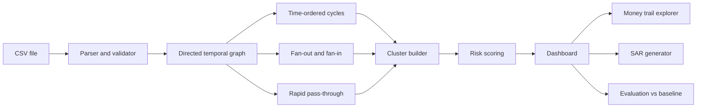

<div align="center">

# 🛡️ PROJECT AEGIS

### AML Financial Intelligence Engine

**Graph-based detection of layered money-laundering networks, with explainable risk scores and auto-drafted SAR reports.**


**Problem Statement 2.1: Graph-Based Detection of Layered Money Laundering Networks**

[Live Demo](#) · [Pitch Deck](#) · [Demo Video](#) · [Report a Bug](https://github.com/ChetanaR-cse/aml-financial-engine/issues)

</div>

---

## 📖 Table of Contents

- [Why Aegis?](#-why-aegis)
- [Key Features](#-key-features)
- [How It Works](#-how-it-works)
- [Risk Scoring](#-explainable-risk-scoring)
- [Architecture](#-architecture)
- [Tech Stack](#-tech-stack)
- [Getting Started](#-getting-started)
- [Input Data Format](#-input-data-format)
- [Demo Walkthrough](#-demo-walkthrough)
- [Evaluation](#-evaluation)
- [Deployment](#-deployment)
- [Project Structure](#-project-structure)
- [Limitations](#-limitations)
- [Roadmap](#-roadmap)
- [Disclaimer](#-disclaimer)
- [Team](#-team)

---

## 🎯 Why Aegis?

Money launderers rarely move dirty money in a single step. They use **layering**: funds are passed through many accounts, split into smaller amounts, and looped back to the starting point so the original source is hidden.

Traditional rule-based monitoring (for example, "flag any transfer above $10,000") struggles here because:

- **Each individual transfer looks normal.** The suspicious signal exists only in the *network*.
- **Launderers deliberately split amounts** to stay below fixed thresholds.
- **Threshold rules generate many false alarms**, wasting analyst time.
- **Investigations and SAR writing are slow and manual.**

**Aegis models accounts as nodes and payments as directed, timed edges**, so laundering shows up as recognisable *shapes* in the graph rather than as isolated transactions. It then scores each suspicious cluster, explains the score, and drafts the compliance report.

---

## ✨ Key Features

| | Feature | What it does |
|---|---|---|
| 📥 | **CSV upload & validation** | Drag and drop a transaction file. Required columns are checked and invalid rows are counted and skipped. |
| 🕸️ | **Directed, weighted, temporal graph** | Accounts become nodes, payments become timed, weighted edges. |
| 🔁 | **Time-ordered cycle detection** | Finds loops where money returns to its source, and only counts them if every hop happens *after* the previous one. |
| 🌪️ | **Fan-out / fan-in detection** | Flags accounts that distribute to, or collect from, many counterparties in a short burst. |
| ⚡ | **Rapid pass-through detection** | Flags mule-like accounts that forward almost everything they receive within hours. |
| 🧩 | **Cluster formation & topology labels** | Connected suspicious accounts are grouped and labelled: circular loop, scatter-gather, fan-out, fan-in, or pass-through chain. |
| 📊 | **Explainable risk score (0–100)** | A six-factor score where every point has a stated reason. |
| 🔎 | **Money-trail explorer** | Click any account to follow its funds through a time-ordered ledger, highlighted on the graph. |
| 📝 | **SAR narrative generator** | Drafts a plain-language Suspicious Activity Report per cluster. Copy or export it. |
| 🧪 | **Evaluation panel** | Precision, recall and F1 versus a threshold-rule baseline, on labelled data. |
| 🎛️ | **Interactive filters** | Loop time window, minimum loop size, fan threshold, and minimum risk score all re-run detection instantly. |
| 🔒 | **Private by design** | The analysis engine runs entirely in the browser. Uploaded files are not sent to a server. |

---

## ⚙️ How It Works

```
CSV upload → Validate → Build graph → Detect patterns → Cluster → Score → Investigate → Report
```

1. **Upload & validate.** The parser accepts common column aliases (`sender`/`from`/`source`, `receiver`/`to`/`target`, and so on), strips currency formatting, and reports skipped rows.
2. **Build the graph.** Each account is a node. Each payment is a directed edge carrying an amount and a timestamp.
3. **Detect three suspicious patterns:**

   | Pattern | Method |
   |---|---|
   | **Time-ordered cycles** | Tarjan's strongly connected components finds groups where money can flow back to its source. A depth-limited search then confirms a cycle whose hops occur in strictly increasing time within the chosen window. |
   | **Fan-out / fan-in** | A sliding 24-hour window counts distinct counterparties. Only material transfers (top 10% by value) are counted, so dust is ignored. |
   | **Rapid pass-through** | A large incoming transfer matched by an outgoing transfer of 85–100% of its value within 24 hours. |

4. **Form clusters.** Flagged accounts connected by transactions form one cluster, which receives a topology label.
5. **Score and rank.** Each cluster gets an explainable risk score, and clusters are ranked.
6. **Investigate.** Analysts open the risk explanation, follow the money trail, and generate the SAR draft.

---

## 📐 Explainable Risk Scoring

Every cluster receives a score out of 100. The score is the sum of six factors, and each factor is displayed with its reason so an analyst can see exactly why a cluster ranked where it did.

| Factor | Max points | What it measures |
|---|:---:|---|
| Layering structure | 30 | Time-ordered loop (30), scatter-gather (24), single fan burst (14), pass-through chain (12) |
| Speed of movement | 20 | How quickly all transfers completed |
| Value at risk | 15 | Total volume moved between the linked accounts |
| Uniform amounts | 15 | How consistent transfer sizes are, which is unusual in genuine commerce |
| Pass-through behaviour | 10 | How many hops forward nearly everything they receive |
| Fan-out / fan-in | 10 | Burst of many counterparties within 24 hours |

> The weights are hand-set heuristics, not learned from real cases. See [Limitations](#-limitations).

---

## 🏗️ Architecture



**Current implementation.** The detection engine, scoring, graph layout, SAR generation, and evaluation are all implemented in TypeScript inside `frontend/app/page.tsx` and run in the browser. This keeps the demo fast, free to host, and private.

**FastAPI service.** The repository also contains a FastAPI backend in `backend/`. The current dashboard does not depend on it. It is intended for heavier analysis at scale (see [Roadmap](#-roadmap)).

---

## 🧰 Tech Stack

| Layer | Technology |
|---|---|
| Framework | Next.js (App Router) |
| Language | TypeScript, React |
| Styling | Tailwind CSS |
| Icons | lucide-react |
| Graph rendering | Inline SVG (no graph library required) |
| Backend (optional) | FastAPI, Uvicorn |

---

## 🚀 Getting Started

### Prerequisites

- Node.js 18 or newer
- npm

### Run the frontend

```bash
# 1. Clone the repository
git clone https://github.com/ChetanaR-cse/aml-financial-engine.git
cd aml-financial-engine/frontend

# 2. Install dependencies
npm install
npm install lucide-react

# 3. Start the development server
npm run dev
```

Open **http://localhost:3000**.

### Build for production

```bash
npm run build
npm start
```

### Run the backend (optional)

```bash
cd aml-financial-engine/backend
python -m venv venv
# Windows: venv\Scripts\activate    macOS/Linux: source venv/bin/activate
pip install -r requirements.txt
uvicorn main:app --reload
```

Adjust `main:app` to match your entry file. The API docs are served at `http://localhost:8000/docs`.

---

## 📄 Input Data Format

Upload a `.csv` file with a header row.

| Column | Required | Accepted names | Notes |
|---|:---:|---|---|
| Sender | ✅ | `sender`, `from`, `source`, `origin`, `payer`, `from_account`, … | Account ID |
| Receiver | ✅ | `receiver`, `to`, `target`, `destination`, `beneficiary`, `to_account`, … | Account ID |
| Amount | ✅ | `amount`, `amt`, `value`, `usd`, … | Positive number. `$` and `,` are handled |
| Timestamp | ➖ | `timestamp`, `time`, `date`, `datetime`, … | ISO 8601 recommended. If missing, row order is used and loop timing is less meaningful |
| Label | ➖ | `is_suspicious`, `label`, `is_laundering`, `fraud`, … | `1` = laundering, `0` = normal. Enables the Evaluation tab |

**Example**

```csv
sender,receiver,amount,timestamp,is_suspicious
ACC-9101,ACC-9102,462000,2026-10-13T03:00:00Z,1
ACC-9102,ACC-9103,455070,2026-10-13T16:00:00Z,1
ACC-9103,ACC-9101,448140,2026-10-14T05:00:00Z,1
ACC-1004,ACC-1022,830.50,2026-10-02T11:20:00Z,0
```

Rows with missing accounts, self-transfers, or non-positive amounts are skipped and counted.

> **Tip:** click **Load demo dataset** on the landing page, or **Download sample CSV** to get a ready-made file.

---

## 🎬 Demo Walkthrough

1. Open the app and click **Try the demo dataset**. The four-stage analysis pipeline plays.
2. Review the **metric cards**: transactions scanned, active clusters, suspicious volume flagged, and the system risk index.
3. Look at the **live topology**. Green dots are normal accounts, red dots are flagged accounts, and arrows show the flow of funds.
4. Pick the top cluster in **Ranked Clusters** and open **Risk explanation** to see each score factor.
5. Open **Money trail**, click an account, and watch the ledger filter and the graph highlight.
6. Open **SAR narrative**, click **Generate**, then **Export**.
7. Open **Evaluation** and change the baseline threshold to compare Aegis with a simple rule.
8. Change **Loop time window** to *30 days* and a slower, lower-risk loop appears.

---

## 📈 Evaluation

When the uploaded file contains a label column, the **Evaluation** tab scores detection **per account** against the labels and compares it with a threshold baseline that flags every account touching a single transfer at or above a chosen amount.

On the built-in synthetic demo dataset (953 transactions), the measured results are:

| Method | Precision | Recall | F1 |
|---|:---:|:---:|:---:|
| **Aegis** | ~100% | ~96% | ~98% |
| Threshold baseline ($10K) | ~73% | 100% | ~84% |
| Threshold baseline ($50K) | ~73% | ~70% | ~72% |

> ⚠️ **Important:** the demo labels are **synthetic**, generated alongside the detector. These figures show that the pipeline works end to end. They are **not** a claim of real-world accuracy. For a genuine evaluation, upload independently labelled data.

---

## 🌐 Deployment

### Frontend (Vercel)

1. Run `npm run build` locally and fix any errors.
2. Push the repository to GitHub.
3. In Vercel, choose **Add New → Project** and import the repository.
4. Set **Root Directory** to `frontend`.
5. Deploy. Vercel detects Next.js automatically.

### Backend (Render, Railway, or Fly.io), only if you connect it

- **Root directory:** `backend`
- **Build command:** `pip install -r requirements.txt`
- **Start command:** `uvicorn main:app --host 0.0.0.0 --port $PORT`
- Enable **CORS** for your frontend URL, and expose the backend URL to the frontend through an environment variable such as `NEXT_PUBLIC_API_URL`.

Hosting plans and limits change, so check each provider's current terms.

---

## 🗂️ Project Structure

```
aml-financial-engine/
├── frontend/
│   ├── app/
│   │   └── page.tsx        # Dashboard, detection engine, scoring, SAR, evaluation
│   ├── package.json
│   └── ...
├── backend/                # FastAPI service (optional, not required by the current UI)
│   ├── main.py
│   └── requirements.txt
└── README.md
```

Inside `page.tsx`, the code is organised as: CSV parsing → detection (cycles, fans, pass-through) → clustering and scoring → layout → evaluation → SAR narrative → demo data → landing visuals → dashboard UI.

---

## ⚠️ Limitations

- **Browser-based scale.** The in-browser engine is suited to files up to roughly 300,000 rows.
- **Heuristic scoring.** Risk weights are hand-set and not trained on real investigations.
- **Template-based SAR.** The narrative is filled from templates with real figures, not generated by a language model.
- **Possible false positives.** Large legitimate hubs such as exchanges or big merchants can resemble fan-in hubs. The fan threshold and minimum-risk filters exist for this reason.
- **Fixed pattern parameters.** The 24-hour fan and pass-through windows, and the 85–100% forwarding band, are not yet user-configurable.
- **Synthetic demo labels.** See [Evaluation](#-evaluation).

---

## 🛣️ Roadmap

- [ ] Python backend for large datasets (NetworkX or a graph database)
- [ ] LLM-generated SAR narratives through a secured API route
- [ ] Learned risk model alongside the explainable rules
- [ ] Draggable, zoomable graph with search
- [ ] Case management: statuses, notes, and false-positive feedback
- [ ] Time-replay slider to watch funds move
- [ ] Structuring and dormant-account detectors
- [ ] Validation on independently labelled real-world datasets

---

## ⚖️ Disclaimer

Project Aegis is a **hackathon prototype for research and demonstration**. It is not a certified compliance product. Generated narratives are **drafts** and must be reviewed and approved by a qualified compliance officer before any filing. Legal references included in the narratives (for example, 18 U.S.C. § 1956 and 31 U.S.C. § 5324) are illustrative and should be verified by a legal or AML professional. Do not use real customer data with this prototype without appropriate authorisation and safeguards.

---

## 👥 Team

**Team Syntax Sugar**

- Chetana R
- Chaithanya S
- Amrutha B G

---

> **Built by Team Syntax Sugar for PS 2.1: Graph-Based Detection of Layered Money Laundering Networks**
>
> *Follow the money, not just the transaction.*
